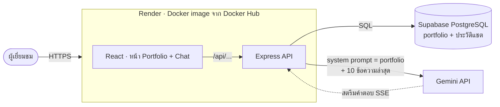

# VISIONQUEST — Chat AI Portfolio

เว็บ Portfolio ของกลุ่ม VISIONQUEST (AIE312 Final Project) ที่ผู้เยี่ยมชมคุยกับ AI ชื่อ **Oracle** ได้โดยตรง
Oracle ตอบเรื่องทีมและสมาชิกแต่ละคนจากข้อมูลจริงในฐานข้อมูล บอกได้ว่าคำตอบอ้างถึงใคร และตอบว่า "ไม่มีข้อมูล" แทนการเดาเมื่อถามนอกเรื่อง

**เว็บที่ deploy แล้ว:** https://visionquest-htn7.onrender.com
(Render แบบฟรีจะหลับเมื่อไม่มีคนใช้ ครั้งแรกอาจโหลดช้าหลายสิบวินาที)

| สมาชิก | บทบาท |
|---|---|
| Popong Faimoon | Lead · AI · CI/CD |
| Natdanai Chaiwongping | Backend + Database |
| Banthita Sakulngam | Frontend |

## สถาปัตยกรรม



- **Monorepo** (npm workspaces): `apps/api` (Express + PostgreSQL), `apps/web` (React), `packages/shared` (types ที่ API กับหน้าเว็บใช้ร่วมกัน)
- **ข้อมูล Portfolio** เขียนเป็นไฟล์ JSON ใน `seed/` แล้วโหลดลงฐานข้อมูลด้วย `npm run seed` (ทำอัตโนมัติทุก deploy)
- **AI:** ทุกข้อความ API จะสร้าง system prompt จากข้อมูล Portfolio ทั้งหมด (`apps/api/src/services/promptBuilder.ts`) ส่งให้ Gemini พร้อมประวัติแชต แล้วสตรีมคำตอบกลับทีละช่วงด้วย Server-Sent Events ถ้าโมเดลหลักติดโควตาจะสลับไปโมเดลสำรองให้เอง

## API

| Method | Path | ทำอะไร |
|---|---|---|
| GET | `/api/health` | สถานะเว็บ + ฐานข้อมูล และ commit ที่ deploy อยู่ |
| GET | `/api/portfolio` | ข้อมูลทีม สมาชิก ทักษะ ผลงาน และช่องทางติดต่อ |
| GET / POST | `/api/conversations` | รายการบทสนทนา / เริ่มบทสนทนาใหม่ `{ firstMessage }` |
| GET / DELETE | `/api/conversations/:id` + `/messages` | ข้อความในบทสนทนา / ลบบทสนทนา |
| POST | `/api/conversations/:id/messages` | ส่งคำถาม `{ content }` แล้วรับคำตอบแบบสตรีม (`token` … `done` / `error`) |

ทุก endpoint ของบทสนทนาต้องส่ง header `X-Client-Id` (เบราว์เซอร์สร้างไว้ครั้งเดียว) และเห็นได้เฉพาะบทสนทนาของตัวเอง
ส่งข้อความได้ 10 ครั้งต่อนาทีต่อผู้ใช้ และ 60 ครั้งต่อนาทีต่อ IP

## รันในเครื่อง

ต้องมี Node 22 และ Docker

```sh
npm install
docker compose up -d                      # PostgreSQL ในเครื่อง (ฐานข้อมูล dev + test)
cp -n apps/api/.env.example apps/api/.env # -n: ไม่ทับ .env เดิม · ใส่ GEMINI_API_KEY / GEMINI_MODEL ถ้าจะใช้แชต
npm run migrate -w @vq/api                # สร้างตาราง
npm run seed -w @vq/api                   # โหลดข้อมูลจาก seed/
npm run dev -w @vq/api                    # http://localhost:3000/api/health
```

ขอ Gemini API key ได้ที่ https://aistudio.google.com ถ้าไม่ใส่ key ทุกอย่างยังใช้ได้ ยกเว้นแชตที่จะตอบว่า "Oracle ขัดข้อง"

## ทดสอบ

```sh
npm run typecheck && npm run lint && npm test && npm run build
```

`npm test` ใช้ฐานข้อมูล `visionquest_test` จาก `docker compose` (เทสต์ที่ต้องใช้ฐานข้อมูลจะถูกข้ามถ้าไม่มี `TEST_DATABASE_URL`)

### AI eval (คุณภาพคำตอบของ Oracle)

ถาม Oracle จริง 12 ข้อ (ทีม 4, สมาชิกคนละ 2, คำถามนอกเรื่อง 2) แล้วตรวจว่าคำตอบอิงข้อมูลจริงหรือปฏิเสธได้ถูกต้อง ต้องผ่านอย่างน้อย 10/12

```sh
npm run eval -w @vq/api                                              # ใช้ฐานข้อมูลและ Gemini key ในเครื่อง
npm run eval -w @vq/api -- --url https://visionquest-htn7.onrender.com  # ถามเว็บที่ deploy แล้ว ไม่ต้องมี key
```

ผลล่าสุดอยู่ที่ [`apps/api/eval/results.md`](apps/api/eval/results.md) · คำถามอยู่ที่ [`apps/api/eval/questions.json`](apps/api/eval/questions.json)

## CI/CD

`.github/workflows/pipeline.yml`
- **ทุก push และ PR (`ci`):** typecheck → lint → test กับ PostgreSQL จริง → build → build Docker image แล้วรันเช็กว่า image ต่อฐานข้อมูลได้
- **ทุก merge เข้า `main` (`deploy`):** push image ขึ้น Docker Hub → migrate + seed ฐานข้อมูล Supabase → สั่ง Render deploy → smoke test รอจนเว็บรายงาน commit ใหม่

`main` ถูกป้องกัน: ต้องผ่าน PR และ `ci` ก่อน merge · ขั้นตอนตั้งค่า production ทั้งหมดอยู่ใน [`docs/deploy.md`](docs/deploy.md)

## เอกสาร

- [`docs/final-project-requirements.md`](docs/final-project-requirements.md): โจทย์ของรายวิชา
- [`docs/superpowers/plans/2026-10-14-visionquest.md`](docs/superpowers/plans/2026-10-14-visionquest.md): แผนงาน Task 1–16
- [`docs/superpowers/plans/2026-11-07-visionquest-team-split.md`](docs/superpowers/plans/2026-11-07-visionquest-team-split.md): แบ่งงานในทีม
- [`seed/README.md`](seed/README.md): วิธีแก้ข้อมูล Portfolio
